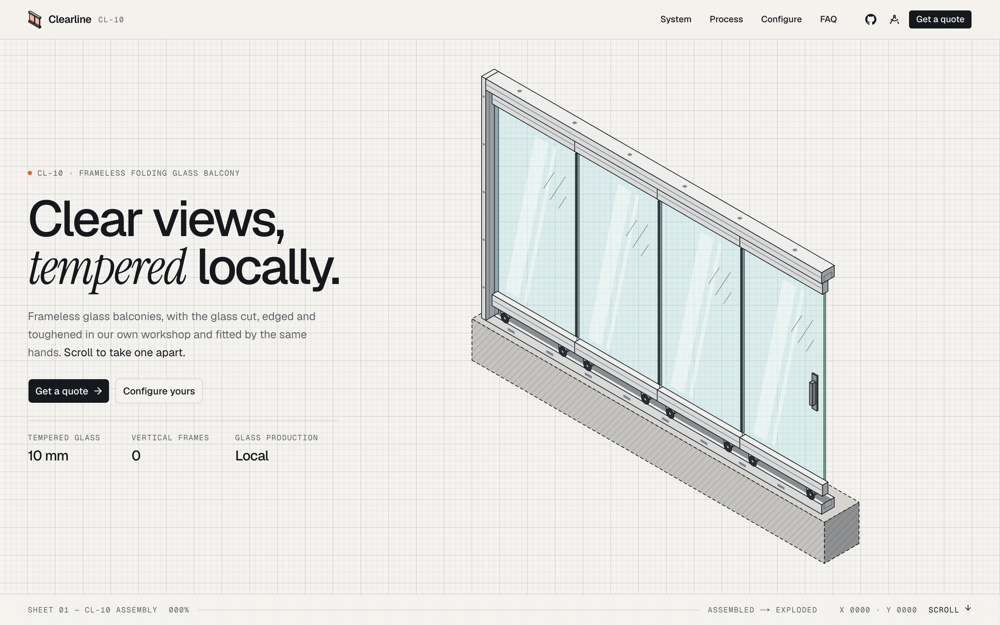

<div align="center">
  
  <h1>Clearline · Glass Balcony</h1>
  <p><strong>An isometric landing page for a local frameless glass balcony workshop, drawn like a technical sheet.</strong></p>

  <p>
    <a href="#features">Features</a> •
    <a href="#demo">Demo</a> •
    <a href="#getting-started">Getting Started</a> •
    <a href="#usage">Usage</a> •
    <a href="#customising">Customising</a> •
    <a href="#project-structure">Project Structure</a> •
    <a href="#tech-stack">Tech Stack</a>
  </p>

  <p>
    
    
    
    
    
  </p>
</div>

## Demo



Live: [https://clearline-balcony.vercel.app/](https://clearline-balcony.vercel.app/)

## Features

- Scroll-driven exploded view that takes a 10-part balcony system apart, piece by piece
- Schedule of parts legend: hover a part to highlight it, click to scroll to its stage
- Pointer-driven glass reflections and an unfolding intro animation
- `Paper` and `Blueprint` themes (light and dark)
- Animated isometric process scenes: Cut, Edge, Temper, Fit
- Live configurator:
  - 4 glass tints: Clear, Smoke, Bronze, Frosted
  - 4 frame finishes: Anodised, Graphite, Bronze, White
  - 3 to 6 panels with live millimetre dimensions
  - Fold open/closed, explode slider and annotation toggle
- SVG and PNG export of the drawing
- `Quote this spec` drops the configured spec into the contact form
- Contact form that opens the visitor's mail app, no backend needed
- Hoverable isometric apartment block
- Respects `prefers-reduced-motion`

## Getting Started

### Prerequisites

- [Node.js](https://nodejs.org/) 20+
- [pnpm](https://pnpm.io/) 10+

### Installation

```bash
git clone https://github.com/hasanharman/clearline.git
cd clearline
pnpm install
pnpm dev
```

Open [http://localhost:3000](http://localhost:3000).

## Usage

1. Scroll through the hero to explode the balcony; hover or click a part in the legend to focus it.
2. Switch between `Paper` and `Blueprint` from the nav.
3. In `Configure`, pick the glass, frame and panel count, then fold or explode the drawing.
4. Export the drawing as SVG or PNG, or press `Quote this spec` to send it to the contact form.
5. Fill in your name and phone and press `Request a site visit` to open an email with the quote.

## Customising

Everything a business would change lives in `src/lib/site.ts`:

```ts
export const site = {
  name: "Clearline",
  tagline: "Frameless glass balconies",
  system: "CL-10",
  city: "Your City",
  phone: "+00 000 000 00 00",
  email: "hello@example.com",
  address: "Workshop · Industrial Zone, Your City",
  hours: "Mon–Sat · 08:30–18:30",
  year: 2026,
  repo: "https://github.com/hasanharman/clearline",
}
```

The same file holds the nav links, process steps, reasons and FAQ copy. Colours for both themes are CSS variables in `src/app/globals.css` (`--signal`, `--face`, `--shade`, `--steel`, …).

## Project Structure

- `src/components/balcony/scene.ts`: balcony geometry, parts list and explode timing
- `src/components/balcony/balcony-drawing.tsx`: SVG renderer with labels, dimensions and camera
- `src/components/iso/`: small isometric primitives used by the process scenes and building
- `src/components/sections/`: one file per page section
- `src/lib/iso.ts`: isometric projection, lighting and easing helpers
- `src/lib/export-svg.ts`: bakes CSS colours into the SVG for export

## Tech Stack

- Next.js 16
- React 19
- TypeScript
- Tailwind CSS 4
- Motion
- shadcn/ui on Base UI

## Contributing

Issues and pull requests are welcome: [hasanharman/clearline](https://github.com/hasanharman/clearline)

## Star History

<a href="https://www.star-history.com/?repos=hasanharman%2Fclearline&type=timeline&legend=top-left">
 <picture>
   <source media="(prefers-color-scheme: dark)" srcset="https://api.star-history.com/chart?repos=hasanharman/clearline&type=timeline&theme=dark&legend=top-left" />
   <source media="(prefers-color-scheme: light)" srcset="https://api.star-history.com/chart?repos=hasanharman/clearline&type=timeline&legend=top-left" />
   
 </picture>
</a>
